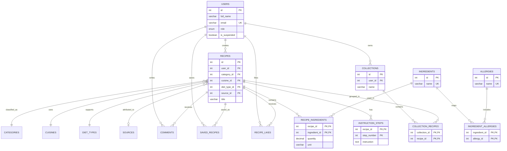

# Cookly Entity-Relationship Diagram

The existing `catergory_id` spelling is retained for compatibility with the current application and database. It should be renamed to `category_id` in a future cleanup migration.
